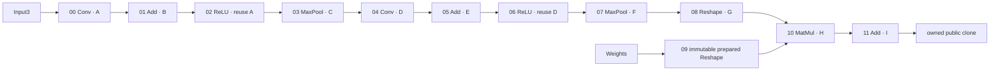

# Performance pass 18: bounded private destination reuse

Pass 18 accepts a deliberately narrow ONNX optimization: Sessions retain exact
static destination tensors, subject to an additional live-memory charge and a
conservative admission proof. Fresh complete-contract comparison: **54.8335 →
51.3330 µs**, **3.5005 µs / 6.3839%** faster. ORT moves **44.375 → 44.209 µs**
(**−0.166 µs / −0.3741%**); ratios are **1.23568× → 1.16114×**. Ordinary warm
allocation falls **92,826 → 1,409 B/op**, **72 → 36 allocs/op**. Each ordinary
MNIST Session instead retains **83,664 logical payload bytes**, approximately
**91,449 bytes of tensor allocation storage**, plus metadata. Cold cost increases.

[Ownership, alternatives and the pre-production fourteen-question gate](tools/compare_runtime/pass18/DESIGN.md)
contain the complete proof. [Replay and evidence](tools/compare_runtime/pass18/README.md),
`data/summary.json`, `data/validation.json` and the lossless compressed evidence
bundle accompany this report. All valid observations and the rejected first
prototype's quota failures are preserved. No NeuralNetwork production code or
module dependency changed.

## 1. Fresh baseline

Measured November 13, 2026: Apple M3, Mac15,13, 24 GB, eight cores (4P/4E),
macOS 26.5.2 / 25F84, Go 1.27.2 darwin/arm64. Baseline ONNX commit
`2b2a0c5fb68d1fcd34b0f21bf501726cf6f35d02` (the exact captured revision is authoritative
in `summary.json`). Published NeuralNetwork **v0.10.10**, upstream commit
`2ffa5bd9fd2034382c49d14efc732ea4d026aa09`, no replacement/workspace. Protobuf
v1.36.12, simd v1.3.0, x/sys v0.45.0. Python 3.9.6, NumPy 1.26.4, ONNX 1.16.2,
ORT 1.19.2, Python protobuf 4.25.3. Timing policy: CGO_ENABLED=0, GOMAXPROCS=1,
GOWORK=off, GOARM64=v8.0, empty GOFLAGS except the preserved control source overlay.
Source fingerprints distinguish measured candidate sources from final comments,
formatting and expanded test coverage. Environment/module provenance is included.

The independent initial fresh report measures **Go 54.875 µs, ORT 42.083 µs,
1.30397×**; three initial ramp samples allocate **92,826 B / 72 objects**.
The primary production estimate uses the seven fresh interleaved pairs in §17,
not this initial single report or any Pass 17 historical observation.

## 2. Destination lifecycle map

Verified against the current prepared calls, backend constructors/Into kernels,
value lifetime planner and a traced real MNIST traversal. Every payload below is
float32 contiguous storage. A fresh tensor has a **96-B header**, **32-B shape**
for rank four or **16-B shape** for rank two, and its own **one-byte identity**
(amortized tiny-allocation accounting). Allocator payload size classes differ
from logical bytes. Metadata is owned by the tensor; its type/shape/identity never
changes. Reused rows introduce no new header/shape/identity.

| Node | Operator / output shape | Logical B | Allocator payload B | Total fresh allocator B | Allocation / first write | Last logical consumer; retirement | Same-Run successor using storage |
| ---: | --- | ---: | ---: | ---: | --- | --- | --- |
| 00 | Conv `[1,8,28,28]` | 25,088 | 27,264 | 27,393 | `cnnCall.run` → `tensor.New`; kernel 00 | Add01; after 01 | ReLU02 |
| 01 | Add `[1,8,28,28]` | 25,088 | 27,264 | 27,393 | `numericalCall.run`; kernel 01 | ReLU02; after 02 | None; incompatible with Pool03 |
| 02 | ReLU `[1,8,28,28]` | 25,088 | 0 new | 0 new | Retired tensor 00; kernel 02 | Pool03; after 03 | None; incompatible with Conv04 |
| 03 | MaxPool `[1,8,14,14]` | 6,272 | 6,528 | 6,657 | `cnnCall.run`; kernel 03 | Conv04; after 04 | None; incompatible with Add05 |
| 04 | Conv `[1,16,14,14]` | 12,544 | 13,568 | 13,697 | `cnnCall.run`; kernel 04 | Add05; after 05 | ReLU06 |
| 05 | Add `[1,16,14,14]` | 12,544 | 13,568 | 13,697 | `numericalCall.run`; kernel 05 | ReLU06; after 06 | None; incompatible with Pool07 |
| 06 | ReLU `[1,16,14,14]` | 12,544 | 0 new | 0 new | Retired tensor 04; kernel 06 | Pool07; after 07 | None; incompatible with Reshape08 |
| 07 | MaxPool `[1,16,4,4]` | 1,024 | 1,024 | 1,153 | `cnnCall.run`; kernel 07 | Reshape08; after 08 | None; incompatible with Reshape09 reservation |
| 08 | Reshape `[1,256]` | 1,024 | 1,024 | 1,137 | `shapeCall.run`; full copy 08 | MatMul10; after 10 | None; incompatible with Add11 |
| 09 | Reshape `[256,10]` | 10,240 | 0 per Run | 0 per Run | Prepared immutable result at load | MatMul10; pinned in plan | Never writable |
| 10 | MatMul `[1,10]` | 40 | 48 | 161 | `numericalCall.run`; kernel 10 | Add11; after 11 | None; no later node |
| 11 | Add `[1,10]` | 40 | 48 | 161 | `numericalCall.run`; kernel 11 | Publication; graph-output pinned | Never an intra-Run candidate |
| | Nine fresh destinations | **83,664** | **90,336** | **91,449** | | | |

All fresh destinations belong to the evaluation in the baseline, with no aliases
to inputs, defaults or initializers: Into validation requires independent storage
identity, including empty tensors. In this graph only node 11 is a graph output;
any numerical value could be declared one in another graph, which pins its entire
Identity group. Publication always clones it. Node 09 borrows an immutable
plan-owned result, separate from original initializer storage and never writable.

Baseline private destinations do not survive cancellation, failure or publication
as runtime-owned references after the evaluation unwinds; their public clones do.
Node 09 survives as long as the plan is referenced, including by Sessions after
Model.Close. In the candidate, captured private destinations survive all Run
outcomes under their Session owner; none becomes visible outside the runtime.

Storage A spans producers 00/02 through consumer 03; D spans 04/06 through 07.
B ends after 02; C after 04; E after 06; F after 08; G after 10; H after 11;
I after publication. The candidate retains A–I in their original creation slots.
Biases and other initializers are immutable pinned sources omitted from the diagram.

## 3. Existing intra-Run reuse

`valueLifetimes` groups Identity aliases, counts consumer occurrences (including
repeated arguments), and retires a whole unpinned group only after its last
consumer completes and outputs validate. Sources, constants, retained prepared
results and graph outputs are pinned. `runStorage.after` clears every retired
member slot; its single `free` candidate retains the invocation's logical charge.
Another retirement drops the prior candidate and releases that charge.

`destination` consumes that one candidate, requires exact dtype AND shape, and
preserves the existing identity. It neither resizes capacity nor clears payload.
A matching borrow reserves only scratch; a mismatch drops the candidate and
reserves a fresh destination. Scratch/live reservation failures first trim the
free candidate and retry, avoiding false failures from optional reuse. Backend
Into validation independently rejects aliasing with current operands.

Only ReLU02 and ReLU06 meet the exact-shape/lifetime requirements above. The
one-candidate policy discards other shapes rather than searching a pool. No
baseline candidate crosses a Run boundary. Pass 18 extends this same destination
choice with a Session slot fallback; existing retirement gets first refusal.

## 4. Ownership design

`Session.destinations` owns a fixed pointer table and lazily captured tensors.
`executionPlan` stores only immutable byte/admission bounds. `evaluation` still
creates private values, symbols and budgets for each call. Successful validated
fresh results are captured once; borrowed destinations and immutable Reshape09
cannot populate another slot. Unsuccessful fresh allocations are never captured.
The runtime does not retain caller input maps, options or public clones.

## 5. Concurrency proof

The existing Session TryLock covers every storage access, synchronous kernel,
publication and Close. Same-Session overlap still returns ErrBusy immediately.
Different Sessions allocate distinct tables/tensors; no global pool or mutable
plan tensor is introduced. Fresh-only capture means slots never share identity.
In a traversal, a slot first becomes active at its creation position; subsequent
intra-Run reuse can move it only forward after all consumers/aliases retire. No
producer is revisited and no later slot can lend storage backward in time.
Thus two live operands/destinations cannot acquire the same cached backing storage.
Cancellation unwinds only after synchronous work returns, then releases the lock.
Concurrent static Sessions, interleaving, Busy/Close, one Session closing while
another stays active, and Model.Close followed by Session use are tested.

## 6. Accounting design

Retained logical numerical payload is a **Session residency charge under
MaxLiveBytes**, in addition to every unchanged legacy invocation reservation.
Current retained bytes seed the active budget; a new successful capture reserves
its extra residency before storing its reference. Retirement releases invocation
charges alone. Intra-Run trimming cannot silently uncharge retained payload.

The admission proof subtracts immutable resident payload, maximum permitted
workspace, all fixed value payloads, MaxTensorBytes for EACH graph input (covering
invalid bindings before declaration checks), and every possible publication copy.
All eligible static destination capacities must fit in the remaining live budget.
Prepared output geometry must equal the inferred fixed geometry used in the proof.
This conservative double charge cannot reject an otherwise valid public Run:
when headroom is insufficient the entire graph uses ordinary allocation.

MNIST immutable resident payload is **34,248 B**, load accounting **502,205 B**.
Session payload is not load work and does not alter MaxLoadBytes. MaxTensorBytes
still checks individual destinations; scratch still obeys MaxWorkspaceBytes.
Go headers, shape arrays, pointer tables, size-class overhead and earlier returned
outputs retain the existing documented exclusion from logical limits. Neither
MaxLiveBytes nor the new counter is an RSS quota. Tensor exposes no physical
allocator capacity; accounting uses ByteSize of the unchanged exact shape.

The default MNIST admission floor is deliberately conservative: **335,855,448
MaxLiveBytes**, approximately 320.3 MiB, because maximum workspace and maximum
possible input binding are reserved in the proof. Actual retained payload is only
83,664 B. Smaller configured limits continue through the original path. Tests
compare success/error diagnostics at every live limit from 8 through 160 bytes
for a small static graph, with tensor/workspace limits fixed, including warm calls.

## 7. Boundedness proof

One tensor per eligible static creation slot; no replacement or shape history.
MNIST normally retains **nine tensors / 36 tensor allocation objects**. The
conservative bound includes both normally reused ReLU slots: **121,296 logical
payload B, eleven tensors / 44 tensor objects**, plus a **96-B twelve-entry table**.
Normal tensor allocation volume is about **91,449 B**; the conservative all-slot
size-class prediction is approximately **132,539 B**, plus the table. Tiny object
packing makes these allocation-volume predictions, not exact retained heap/RSS.
The Session container grows from a 24-B to an 80-B allocation on this build.

Generally, retained bytes cannot exceed the proven static capacity sum or live
headroom, and tensor count cannot exceed prepared steps (bounded by MaxNodes).
Per-model Session retention is further bounded by MaxSessions times that bound.
With default sixteen MNIST Sessions, the conservative payload bound is 1,940,736 B.
Zero-sized outputs retain no tensor objects. No dynamic workload can grow this set.

## 8. Dynamic-shape behavior

Unknown/symbolic inferred dimensions, unavailable preparation, mutable Reshape
shape inputs, unsupported operators or incomplete geometry disable retention for
the whole graph. Stable dynamic shapes therefore receive no new reuse benefit.
Changing dimensions, zero-size transitions, default and initializer overrides
continue through existing validation and allocation. Static numerical overrides
with unchanged declared geometry can reuse destinations; their payload values
remain fully runtime-dependent. Tests cover these overrides and immutable defaults.

No slice-capacity reshaping is attempted: backend shape/length/identity metadata
is immutable, and a bigger payload is not semantically interchangeable with a
smaller tensor. Mismatched type/rank/shape is rejected by slot lookup. An occupied
slot cannot be replaced. Dynamic `[1,3,0,100,2]` batch sequences retain **zero**
payload; measured candidate overhead is +32 B per evaluation and about **1.541 →
1.563 µs** in this small workload. Capacity replacement is intentionally absent;
shape changes allocate through the baseline path instead of accumulating capacity.

## 9. Failure/cancellation behavior

Every admitted kernel fully overwrites a successful destination: Conv initializes
local accumulators and assigns all interior/border/tail outputs; Add assigns or
copies all results; MaxPool assigns every window; Reshape copies the whole payload;
MatMul stages a complete product and commits it, explicitly clearing zero
contractions; ReLU writes every element and retains existing NaN/cancellation
restoration. Empty outputs have no bytes to initialize. Backend returned errors
preserve destination except cancellable ReLU's documented prefix, which ONNX
already restores. Context errors may follow complete synchronous writes.

A failed node returns before installing its result or running another consumer.
A later Run receives a new value table/symbol map and cannot bind an old result.
A retained tensor may hold stale data, but its next successful producer overwrites
all bytes before validation/publication. Poisoned destinations, zero contractions,
partial ReLU chunk cancellation followed by different-valued recovery, every
polling boundary on a static multi-node graph, deterministic deadlines and late
handler failure followed by different inputs explicitly verify this. The injected
handler failure changes only test-private plan state; public plans are immutable.
No cancellation checks or legacy restoration paths were removed.

Fresh large-tensor construction measures **1.495 µs / 27,393 B / four objects**;
clearing existing storage **0.3854 µs**, copying **0.3626 µs**, neither allocating.
These isolated operations are not additive whole-Run savings. No new preclear runs.

## 10. Close behavior

Session.Close zeros retained references and counters while holding the existing
mutex, then releases its plan slot. It is idempotent; active Close returns Busy
without cancellation/waiting. Logical cleanup never waits for GC. Physical Go
heap reclamation still does. Model.Close drops only the Model's reference;
Sessions remain valid and own their resources until their own Close.

Lifecycle observations: model load retains 34,248 B immutable numerical payload;
Session creation retains zero destination payload and allocates its finite table;
first successful Run retains 83,664 B, repeated Runs stay there; dynamic Sessions
retain zero; Session.Close returns destination counters/references to zero;
Model.Close prevents new sessions and drops its plan reference. Tests cover
success, cancellation/failure, repeated create/Run/Close, concurrency, and output
survival after both closes. Old public clones are never reclaimed for reuse.

## 11. Candidate comparison

The pre-production table in [DESIGN.md](tools/compare_runtime/pass18/DESIGN.md)
compares fixed static creation slots, a bounded capacity cache and reusable
Run-storage instances. Fixed slots capture the demonstrated MNIST mechanism
without shape mutation, replacement transients, reusable caller-reference tables
or a second allocator. Broader capacity/Run-state reuse adds accounting and
lifecycle obligations without demonstrated additional MNIST destination benefit.

## 12. Prototype result

The first overlay prototype was rejected after full-suite exact-live tests found
optional retention consuming publication headroom when tests lowered private
plan limits after loading. Its original source snapshots and complete failure log
remain in evidence. Revision 2 adds the computed minimum-live admission guard.
The public plan's limits are immutable, but the guard also respects effective
internal budgets. No test expectations or quotas were loosened.

Revision 2 passes full CGO-disabled tests and focused race validation before
production changes. Five interleaved ramp observations give control **55.072 µs**,
prototype **48.580 µs**, **1,409 B / 36 objects** warm; all observations, including
**60.679 µs**, are retained. Supplementary identical-policy prototype diagnostics, collected after initial
production application and before final acceptance, measure cold Run **60.063 µs / 92,864 B / 72 objects**, construction/Close
**0.05778 µs / 176 B / two objects**, alternating Sessions **49.384 µs**, two-worker
concurrent Sessions **25.000 µs per operation**, binding-failure/recovery pair
**49.813 µs**, cancel/recovery pair **49.370 µs**, dynamic sequence **1.570 µs**.
Single-Run cold counters include timer-barrier tiny-object packing; see §15.

## 13. Production decision

All fourteen ownership/accounting/concurrency/lifecycle/cost questions have explicit
answers in the gate document. Accept the bounded static candidate. Full production
validation and repeated fixed-policy improvement support final acceptance. The
retention trade is explicit; the optimization makes no claim for dynamic graphs
or cold-only Sessions. No backend production change or handoff is necessary.

## 14. Production implementation

The focused ONNX implementation adds `destinationStorage`, immutable plan admission
bounds, Session attachment/Close cleanup, one fallback in existing destination
selection and fresh-result capture after validation. Immutable prepared Reshape
opts out of mutable slots. Existing intra-Run reuse remains first. No argument
arrays, MatMul, Pool, Conv, ReLU, output cloning, backend APIs or dependencies are
optimized in this pass. Production source and focused tests are committed
in `7525766659926bc9e47f4100de3821c676e4ba12`, separately from
report/replay/evidence files; the PR retains the repository template.

## 15. Initialization/amortization

Model loading performs an additional static admission walk. Session construction
and Close measure **0.02494 → 0.05736 µs**, **24 B / one object → 176 B / two objects**.
Payload allocation remains lazy. Dedicated cold Run measures **56.721 → 59.263 µs**,
**92,832 → 92,864 B**, **72 objects** in both. Stop/start-timer barriers change tiny
packing by approximately six bytes versus ordinary Run counters; that difference
is not attributed to a new tensor. First call in ordinary batch accounting is
**92,858 B / 72 objects**, before Session/table construction.

The following measurements include Session creation, N calls and deterministic
Close, exclude model loading/input preparation, and use seven observations per row.

| Runs per Session | Control total µs | Candidate total µs | Candidate mean µs/Run | Candidate total B / objects |
| ---: | ---: | ---: | ---: | ---: |
| 1 | 55.439 | 56.357 | 56.357 | 93,034 / 74 |
| 2 | 112.012 | 106.839 | 53.4195 | 94,443 / 110 |
| 10 | 558.527 | 502.910 | 50.2910 | 105,715 / 398 |
| 100 | 5,599.812 | 4,951.035 | 49.5104 | 232,525 / 3,638 |
| Warm ordinary ramp | 55.721/Run | 48.828/Run | 48.828 | 1,409 / 36 per Run |

Measured break-even is **two calls** among the tested counts. One-call lifecycle
is **0.918 µs slower**; dedicated cold Run is **2.542 µs slower** in its different
timer/GC scope. Neither is hidden or replaced by a theoretical 8-µs saving.
Ranges/CVs/all observations are in summary.json. Loading remains outside inference
measurements. Separate sequential loading blocks measure **371.836 → 375.668 µs**,
**345,857 → 345,806 B / 2,567 → 2,566 objects**. They include compiler/allocation
layout effects and are not an isolated causal estimate of the admission walk;
all loading samples are retained.

## 16. Retained-memory economics

Previously nine destinations allocated 91,449 allocator B / 36 objects EACH Run.
Now those tensors are retained after first use: 83,664 logical B, approximately
90,336 allocator payload B + 864 header B + 240 shape B + nine tiny identity bytes.
A 96-B pointer table adds one object, and the existing Session allocation grows
by 56 B. Ordinary net allocation reduction is **91,417 B/Run**, because evaluation
metadata grows by 32 B. Allocation elimination is a lifetime trade.

| Sessions | Retained logical payload B | Tensor allocation volume + pointer tables B | Additional Session container B |
| ---: | ---: | ---: | ---: |
| 1 | 83,664 | 91,545 | 56 |
| 10 | 836,640 | 915,450 | 560 |
| 100 | 8,366,400 | 9,154,500 | 5,600 |

One hundred Sessions require raising MaxSessions or spreading Sessions across
Models; the default per-model limit remains sixteen. These figures exclude the
shared immutable model and independently owned caller outputs. They are not RSS
predictions. No replacement allocation occurs for an occupied slot; changing
geometry falls back to baseline allocations with no Session destination retention.

## 17. Complete-runtime result

Unchanged fixed policy: upstream, zeros, ones, sixteen seed-0 uniform-random
inputs, nineteen sorted cases, ten warmups and 100 timed calls per case; Go then
ORT within every report; independent owned outputs; atol=1e-4/rtol=1e-5; unchanged
conversion, upstream consistency and top-1 checks; builds, loading and serialization
outside timing. Seven version pairs alternate outer control/candidate order.
Every report passes numerical/upstream/top-1 checks; every engine has 1,900 samples.

| Scope | Control median µs | Candidate median µs | Control range µs / CV | Candidate range µs / CV |
| --- | ---: | ---: | --- | --- |
| Fixed-policy Go | 54.8335 | 51.3330 | 53.5205–55.125 / 1.1118% | 50.604–51.834 / 0.6779% |
| Fixed-policy ORT | 44.3750 | 44.2090 | 41.958–45.000 / 2.7204% | 42.083–45.042 / 2.3417% |
| Ordinary Go ramp | 55.7210 | 48.8280 | 54.838–58.719 / 2.7310% | 48.403–51.157 / 1.8254% |

Primary difference of medians of per-report Go medians: **3.5005 µs / 6.3839%**.
ORT movement: **−0.1660 µs / −0.3741%**. Ratios: **1.2356845× → 1.1611437×**.
Secondary paired Go difference median: **3.291 µs**, range **2.1875–3.729 µs**, CV
**15.6269%**; all seven pairs improve. Separate ordinary ramp improvement is
**6.893 µs / 12.3706%**, **92,826 → 1,409 B/op**, **72 → 36 allocs/op** in every
sample. The ramp and fixed-policy workloads have different inputs/timing scopes;
the larger ramp recovery is not substituted for the primary estimator.

Alternating warm Sessions measure **56.035 → 49.257 µs**, steady single-worker
concurrent fixture **56.036 → 49.487 µs**; two-worker throughput benchmark
**31.646 → 25.128 µs/op** (wall time per completed operation, not individual
latency). Per-worker initialization causes small amortized B/op above 1,409.
Binding-failure/recovery pairs measure **57.201 → 49.836 µs**; pre-cancel/recovery
pairs **56.300 → 49.600 µs**. All raw values are retained. Purego fixed-policy
comparison passes separately; its Go median is **259.1665 µs**, outside native
performance claims. Reference movement is never normalized to historical ORT.

## 18. Correctness validation

Full default, CGO-disabled, purego, race and purego+race suites pass. Final focused
lifecycle tests also pass each configuration after coverage expansion. Existing
suites cover dynamic/symbolic shapes, initializer defaults and overrides, aliases,
output survival, cancellations/deadlines, failure recovery, Busy/Close,
load/live/workspace/tensor quotas, concurrent Sessions and invalid states.

New tests cover repeat success and residency/invocation balance; cached-pointer
stability; poisoned payloads; zero contractions/empty tensors; every cancellation
and deterministic deadline boundary; ReLU chunk cancellation; changed-valued
failure recovery; no shape replacement; dynamic sequences retaining zero;
static default/override and graph-output aliases; output survival after both
closes; same-Session Busy/Close; truly simultaneous independent Sessions;
interleaved close/isolation; repeated creation/Close; exact live-limit equivalence.

All twelve default/purego cross-builds pass: darwin arm64/amd64, linux arm64/amd64,
windows amd64, linux 386, CGO disabled. Four three-second fuzz smoke targets pass:
FuzzProtobufEntrypoints, FuzzTensorDecode, FuzzGraphReferences and
FuzzShapeAttributePlanning. Formatting, vet, module verify and tidy -diff pass.
No required test failure is suppressed. Commands, exits, overrides and durations
are retained in validation.json, including pre-production rejection evidence.

## 19. Metal validation

Sandbox serialized ONNX/backend Metal suites pass, with **46 backend skips** due
to unavailable Metal devices. Native host serialized full suites pass with **zero
skips**, followed by **five successful repetitions** of
Test_SequentialResidentLongRunningMixedStress and final focused ownership tests.
The evidence retains both environments separately. No new unrestricted failure
was observed or silently discarded; this pass uses serialized native validation.
Pass 16's historical unrestricted stress failure remains unexplained. Current
passes neither explain nor resolve it. Host-side inference claims use no Metal tag.

## 20. Updated allocation ledger

Fresh ordinary warm counters and allocation-rate-one profile confirm the removal
of recurring destination construction. Source ownership and exact ordinary
counters give this disjoint ledger (allocator-rounded bytes, tiny-byte convention):

| Purpose | B/Run | Objects/Run |
| --- | ---: | ---: |
| Run/evaluation/budget/value table/symbol map | 480 | 4 |
| Node argument arrays | 160 | 12 |
| Conv/Pool/Reshape validation geometry | 144 | 5 |
| MatMul plan/result/staging | 144 | 3 |
| Final Add adapters | 288 | 6 |
| Owned output/publication | 193 | 6 |
| Recurring private destinations, warm | 0 | 0 |
| **Total** | **1,409** | **36** |

Cold setup tensors appear once in the heap profile, whose scope contains the
benchmark warm invocation plus 1,000 timed invocations. Tiny objects are coalesced
and profile object samples are not the ordinary allocation count. Do not divide
all samples by 1,000 or call the profile's ~35 Run-focused objects an exact census.
The remaining 32-B increase over Pass 17's diagnostic ceiling is evaluation storage.

## 21. Updated runtime decomposition

Fresh component medians, with destinations prepared and allocation outside their
timing, are diagnostic scopes and do not sum to an exact complete Run:

| Component | µs |
| --- | ---: |
| Conv00 | 7.749 |
| Conv04 | 27.279 |
| Add01 / Add05 / Add11 | 1.986 / 1.222 / 0.1858 |
| Pool03 / Pool07 | 2.614 / 0.9954 |
| MatMul10 | 1.702 |
| ReLU02 / ReLU06, including ONNX correction | 0.8286 / 0.4394 |
| Complete owned publication | 0.1159 |
| Prepared graph fixture | 45.841 |
| Evaluation creation + bind | 0.9508 |
| Warm complete ordinary Run | 48.828 |

The prepared graph fixture uses disjoint preallocated destinations and performs
a weight Reshape copy that ordinary prepared execution retains; its **2.987-µs**
gap to warm Run is not an additive recoverable machinery estimate. ReLU and
publication have fresh separate diagnostics in summary.json; their semantics and
ownership are unchanged. CPU sampling places Conv execution at **58.72% cumulative**
and the eight-filter interior/residual bodies at **55.11% flat**, Add and Pool
about **5.96% cumulative each**, MatMul **4.26%**, ReLU about **2.13%**. Runtime
madvise accounts for **12.13% flat** in this sample; it is background/runtime work,
not evidence for an identified remaining destination allocation. Sampling shares
are not exact wall-time decomposition or recoverable savings. Allocator volume
no longer supports another large destination-allocation objective.

## 22. Updated 1.25× roadmap

Using candidate's fresh ORT **44.209 µs**, a 1.25× threshold is **55.26125 µs**.
Candidate Go **51.333 µs** is below it by **3.92825 µs**; the current ratio is
**1.16114×**. The paired control is already below 1.25× because the reference
also moved relative to the initial fresh/historical baseline. This is a valid
current measurement, not proof that Go alone crossed the milestone. No historical
ORT normalization is used.

## 23. Updated 1.10× roadmap

The same fresh ORT gives **48.6299 µs** at 1.10×. Reaching it from the complete
fixed-policy candidate requires another **2.7031 µs / 5.2658%** Go reduction if
ORT stays unchanged. Ordinary ramp latency cannot substitute for that workload.
No sum of tiny adapter/argument diagnostics is claimed to supply this amount.

## 24. Recommendation for Pass 19

Do a new investigation of the post-retention critical path before selecting a
production target. Prioritize measuring remaining ONNX traversal/validation work
against an accurately matched prepared graph, and compare current kernel/fusion
boundaries with fresh ORT evidence. Conv04 remains the largest sampled component,
but this pass does not reopen it or establish a new backend optimization. The
remaining 1,409-B ledger can guide allocator experiments; it does not itself
justify a latency claim. Reject a small adapter/argument change unless a new
controlled complete-contract result supports it. No next production mechanism or
backend handoff is predetermined by the old 8-µs destination diagnostic.
